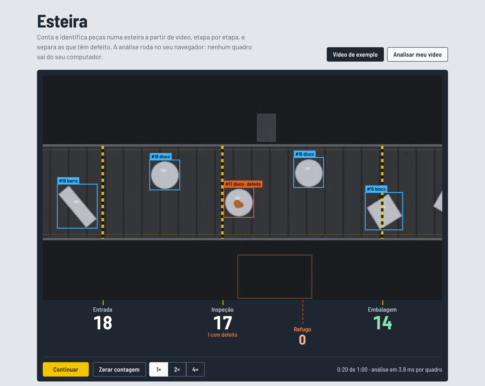

# Esteira

Conta e identifica peças numa esteira a partir de vídeo, etapa por etapa, e separa as que têm defeito. A visão computacional roda no navegador: nenhum quadro do vídeo sai do computador de quem usa.



## O que faz

- Identifica cada peça no vídeo e classifica a forma (disco, bloco ou barra), mesmo com a peça girada.
- Detecta defeito por oxidação na superfície da peça.
- Segue cada peça de um quadro para o outro e conta quando ela cruza as linhas de **Entrada**, **Inspeção** e **Embalagem**.
- Percebe quando uma peça passa pela inspeção e sai da linha antes da embalagem, e conta essa peça como **refugo**.
- Mostra peças por tipo e etapa, ritmo em peças por minuto, registro de eventos (exportável em CSV) e conferência com o gabarito.
- Aceita o vídeo de quem usa, com ajustes da faixa da esteira, da posição das linhas e da sensibilidade.

## Resultado no vídeo de exemplo

O vídeo de exemplo é gerado por `scripts/gerar_video.py`, que também grava um gabarito com o tipo, o defeito e o horário de cada peça. O detector nunca lê o gabarito para contar; ele serve só para medir a precisão.

| Medida | Contado / esperado |
| --- | --- |
| Entrada | 54 / 54 |
| Inspeção | 54 / 54 |
| Com defeito | 7 / 7 |
| Refugo | 7 / 7 |
| Embalagem | 47 / 47 |

As 20 contagens (total e por tipo) batem com o gabarito. O mesmo vale para um segundo vídeo, gerado com outra semente e 90 segundos (83 peças), e quando a análise usa só 1 de cada 2, 3 ou 4 quadros, como num navegador lento. A análise leva cerca de 1,5 ms por quadro em Node e 4 ms no navegador, na resolução de 480 × 270.

## Como funciona

1. **Redução.** Cada quadro é desenhado num canvas de 480 px de largura.
2. **Segmentação.** Dentro da faixa da esteira, um pixel é peça quando é mais claro que a esteira ou tem tom de oxidação.
3. **Componentes conectados.** Pixels vizinhos viram uma peça (vizinhança 8, com união e busca).
4. **Atributos que não mudam com a rotação.** O alongamento vem dos momentos de segunda ordem (razão entre os eixos). A compacidade é a área dividida pela área do círculo que envolve a peça. Disco: alongamento ~1 e compacidade ~1. Bloco: alongamento ~1 e compacidade ~0,64. Barra: alongamento alto.
5. **Defeito.** Proporção de pixels com tom de oxidação acima de 3% da área.
6. **Rastreamento.** Cada detecção é ligada à peça mais próxima da posição prevista pela velocidade. Isso tolera quadros pulados. Tipo e defeito são decididos por votação ao longo dos quadros, ignorando os quadros em que a peça aparece cortada na borda.
7. **Contagem.** Uma peça conta numa etapa quando o centro cruza a linha da esquerda para a direita. Se passou pela inspeção e sumiu antes da embalagem sem sair pela direita, vira refugo.

O código da visão está em `src/visao/`, sem dependências, e é o mesmo usado pelo navegador, pelos testes e pela avaliação.

## Rodar localmente

```bash
npm install
npm run dev          # painel em http://localhost:5173
npm test             # testes da segmentação, classificação, rastreamento e contagem
npm run avaliar      # roda o vídeo de exemplo quadro a quadro e compara com o gabarito (requer ffmpeg)
npm run avaliar -- --pular 3          # simula um navegador que perde quadros
npm run gerar-video  # gera de novo o vídeo e o gabarito (requer Python 3, Pillow, NumPy e ffmpeg)
```

## Limites

- **O vídeo de exemplo é sintético.** Iluminação controlada e peças claras sobre esteira escura. É o cenário em que a segmentação por brilho funciona bem.
- **Peças encostadas** viram uma só. O gerador mantém um espaço mínimo entre elas.
- **Vídeo real de fábrica** costuma pedir ajuste de iluminação e, conforme o caso, um detector treinado (por exemplo, YOLO) no lugar da segmentação por brilho. O rastreamento, a contagem por etapa e o painel continuam os mesmos.

## Dados

Linha, peças e empresa são fictícias.

## Licença

Todos os direitos reservados. Veja [LICENSE](LICENSE). Ler o código e rodar localmente para avaliar é permitido; copiar, modificar ou reutilizar exige autorização por escrito.

Desenvolvido por João Guilherme Gomes de Araújo · [ClairiX](https://clairix.enterprises/cases)
